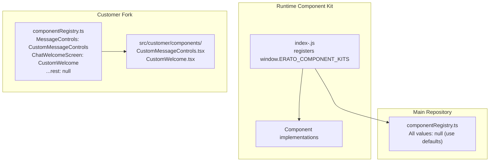

# Component Customization

Erato provides a component registry system that allows deployments and custom builds to override specific UI components without modifying core application code. Runtime component kits are the preferred packaging mechanism for deployment-specific components, while customer forks can still register compiled-in overrides.

## Overview

The component registry pattern provides:

- **Runtime packaging** - Component kits can be deployed outside the main frontend bundle
- **Minimal merge conflicts** - Custom builds can keep overrides isolated in `componentRegistry.ts`
- **Type-safe contracts** - TypeScript ensures custom components match expected props
- **Granular control** - Override individual components without touching any core files

## How It Works



## Runtime Component Kits

Component kits are discovered by the backend from `frontend.component_kits.directory`.
Each direct subdirectory is one kit. The backend serves kit files under
`/public/component-kits/<kit-name>/`, injects a root `index-<hash>.js` module
before the main frontend bundle, and injects a root `.css` file when present.

Kits self-register by pushing a `ComponentKitRegistration` into
`window.ERATO_COMPONENT_KITS`. Priorities are per component; lower numbers win.
When priorities are equal, the last loaded component wins.

```ts
import type { ComponentKitRegistration } from "@erato/frontend/library";

window.ERATO_COMPONENT_KITS ??= [];
window.ERATO_COMPONENT_KITS.push({
  name: "my-kit",
  // The ERATO_SHARED_SURFACE_MINOR this kit was built against, as a literal.
  builtAgainstSharedSurfaceMinor: 11,
  components: [
    {
      extensionPoint: "ChatWelcomeScreen",
      component: MyWelcomeScreen,
      priority: 50,
    },
  ],
} satisfies ComponentKitRegistration);
```

### Two ways an extension point hands work to a kit

An override gets either composed nodes or host components to place, and which
one a point uses follows from who owns the layout:

- **Composed nodes**, where the information architecture is the host's and the
  kit owns the skin. The chat history row works this way: one hook,
  `useChatHistoryRow(props, session)`, returns the row's title, `badges`,
  `subline`, accessible name and an already-gated `menuItems` array. A rule
  added to any of them reaches every override without the kit being rebuilt,
  and the trade is that the host owns that markup — a kit restyles it through
  CSS rather than rebuilding it.
- **Host component slots**, where the kit owns the layout. `ChatMessage` works
  this way: `CHAT_MESSAGE_HOST_COMPONENTS` hands the kit pieces to place
  wherever it likes, because a message's arrangement is the thing a customer
  most wants to change.

A new extension point should copy one of these, not invent a third.

### Declaring the surface a kit was built against

An extension point's contract can grow a rule that an override has to carry —
the chat history row, for instance, gained composed badges, a subline and a
gated action menu. An override written before that rule existed cannot be
carrying it, and it fails silently: no error, no warning, just a shipped
feature missing from the customer's UI.

`builtAgainstSharedSurfaceMinor` is how a kit states which contract it knows.
Write it as a literal — importing `ERATO_SHARED_SURFACE_MINOR` and passing that
would only ever agree with itself, because the import map resolves it to the
running host. Leaving it out is read as the oldest possible contract, not as
"no opinion".

The same key is accepted on an individual entry of `components`, where it
overrides the kit-level value for that point alone. That is how you attest to
the one override you actually rebuilt without vouching for the others.

The host records a required minor per extension point and compares the two. A
kit that is behind for one point is reported by name, with the point and the
value to declare. What happens next is one switch the deployment owns:

```html
<script>
  window.ERATO_COMPONENT_KIT_VERSION_STANCE = "enforce";
</script>
```

Set it in the same script slot that loads the kit bundles, before the app entry
point runs. The default is `"warn"`: the mismatch is reported and the override
is installed anyway, which is what a fleet of kits that declare nothing needs.
`"enforce"` makes the host render its own component for that one point instead,
leaving the kit's other overrides installed. Flip it once every kit this
deployment loads declares a `builtAgainstSharedSurfaceMinor` at or above each
point's requirement — before that, enforcing reverts customer UI that may be
perfectly current.

### Running the host's contract suite

Declaring a minor says which contract a kit knows about; the suite says whether
its override actually carries it. `@erato/frontend/conformance` exports
host-authored cases that render an override and check the row behaviours a kit
is required to keep — the archived marker, the delegated-run origin line, the
status dot, and every gate on the action menu including the confirmation an
archive has to ask for while a chat is still generating or waiting on a tool
approval.

It is a separate package export rather than part of `@erato/frontend/shared`
because everything on the shared surface is downloaded by every end user, and
this is test infrastructure. Import it only from test files; the kit manifest
check rejects it anywhere else.

```ts
import { chatHistoryListConformanceFailures } from "@erato/frontend/conformance";

it("keeps the row contract", () => {
  expect(
    chatHistoryListConformanceFailures(MyChatHistoryList, {
      render: (element) => render(element),
      openRowMenu: (container) => openMyTrailingMenu(container),
    }),
  ).toEqual([]);
});
```

The suite checks that the required menu ids are present, with the required
disabled and confirmation flags. Order is not read at all: a kit is free to
reorder the host's items, insert its own anywhere, and give any item its own
icon or label. Ids the host gates OUT for a row must stay out: an item rendered
inert is worse than one that is missing.

The suite runs in the kit's own test build, which has to resolve React, Lingui,
React Query and the routers to the same copies the host uses; two copies and the
hooks read module instances the host never wrote. `@erato/frontend/component-kit/vite`
exports that list, derived from the host import map, so a vitest config spreads
it rather than copying it:

```ts
import { eratoComponentKitTestDedupe } from "@erato/frontend/component-kit/vite";

export default defineConfig({
  resolve: { dedupe: [...eratoComponentKitTestDedupe] },
  test: { environment: "jsdom" },
});
```

If a deployment policy removes an action outright — no sharing, say — name its
id in a third argument so the cases stop requiring it:

```ts
chatHistoryListConformanceFailures(MyChatHistoryList, harness, {
  omit: [CHAT_HISTORY_ROW_MENU_ID.share],
});
```

The call site is the record of what was dropped, and an id no case requires is
reported as a failure rather than quietly ignored. Reach for it instead of
deleting the test: one case a kit considers correct should not cost it every
other case.

The cases find a row by `CHAT_HISTORY_ROW_TEST_ID.row` and read the badges
through the other ids on that record, so an override has to satisfy two
structural rules: the row element carries that attribute, and the row's
accessible name is on that element or on an ancestor of it.

`component-kit-example/src/components/ExampleChatHistoryList.test.tsx` is a
working harness for a kit that passes the gated array to the host's
`DropdownMenu`: it stubs that one export so `openRowMenu` can return the items
the menu was handed. A kit that draws its own menu component stubs that
component the same way and returns the array it was handed — `openRowMenu`
returns `DropdownMenuItem[]`, and `id` and `confirmAction` have no DOM
projection to read before a click. The stub has to be installed by the test
file's own `vi.mock` factory, so this is one thing the host cannot hand over
ready-made.

The main frontend loads a small runtime entrypoint first, then component kit
entrypoints, then the main app entrypoint. Component kits can assume
`window.ERATO_REACT` and `window.ERATO_LINGUI_REACT` are set when their
entrypoint evaluates and should use those host singletons rather than bundling
separate React or Lingui runtime copies. The example package in
`component-kit-example/` registers all current extension points and builds to
the expected `index-<hash>.js` plus `style.css` layout.

Component kits can ship optional translation catalogs at
`locales/<locale>/messages.json` inside their built directory. The frontend
uses the registered kit names to load those catalogs from
`/public/component-kits/<kit-name>/locales/<locale>/messages.json` and merges
them into the same Lingui catalog as the main frontend before rendering custom
components.

## Available Override Points

| Registry Key                    | Location            | Props Interface                      | Description                                                                                                        |
| ------------------------------- | ------------------- | ------------------------------------ | ------------------------------------------------------------------------------------------------------------------ |
| `AssistantFileSourceSelector`   | Assistant form      | `FileSourceSelectorProps`            | File source selector when adding default files to an assistant                                                     |
| `ChatFileSourceSelector`        | Chat input          | `FileSourceSelectorProps`            | File source selector when uploading files to a conversation                                                        |
| `ChatInputAttachmentPreview`    | Chat input          | `ChatInputAttachmentPreviewProps`    | Staged attachments inside the chat composer, above the textarea                                                    |
| `ComposerContextChipFace`       | Chat input          | `ComposerContextChipFaceProps`       | A context chip's face; the host keeps the lane, (x)/(+), focus, detail and announcements                           |
| `ChatGroupedAttachmentsPreview` | Attachment groups   | `GroupedFileAttachmentsPreviewProps` | Grouped attachment preview cards or chips                                                                          |
| `ChatHistoryList`               | Chat sidebar        | `ChatHistoryListProps`               | Chat history list rows and actions                                                                                 |
| `ChatWelcomeScreen`             | Chat empty state    | `WelcomeScreenProps`                 | Empty state shown when a chat has no messages                                                                      |
| `StarterPrompts`                | Chat welcome screen | `StarterPromptsRendererProps`        | Starter prompt suggestion presentation                                                                             |
| `AssistantWelcomeScreen`        | Assistant chat      | `AssistantWelcomeScreenProps`        | Empty state shown when opening an assistant chat                                                                   |
| `MessageControls`               | Every message       | `MessageControlsProps`               | Action buttons below each message                                                                                  |
| `ChatMessageRenderer`           | Every message       | `ChatMessageProps`                   | Entire message layout                                                                                              |
| `ChatTopLeftAccessory`          | Chat shell          | `ChatTopLeftAccessoryProps`          | Model picker slot in the chat top bar; the host positions it in flow, the kit owns the control and its inner inset |
| `EratoEmailCodeBlock`           | Message code block  | `EratoEmailCodeBlockProps`           | Custom renderer for `erato-email` fenced code blocks                                                               |
| `HostCardCodeBlock`             | Message code block  | `HostCardCodeBlockProps`             | Renderer for fence tags a host lists in `HostArtifact.cardFenceLanguages`; unregistered, they stay code blocks     |

Each example is available in `frontend/src/customer/examples/` and can be copied to `frontend/src/customer/components/` as a starting point.

## Quick Start

For any override, the process is the same:

1. Copy the example from `src/customer/examples/` to `src/customer/components/`
2. Modify it to your needs
3. Import and register it in `src/config/componentRegistry.ts`

---

## Message Controls

The `MessageControls` override replaces the action bar shown below every chat message. The default implementation shows copy, edit, raw markdown toggle, and feedback buttons. Custom implementations can add reactions, metadata badges, dropdown menus, or any other per-message UI.

> **Example:** `frontend/src/customer/examples/MessageControls.example.tsx`

### Props Interface

All feature props beyond the core four are optional — your component only needs to use what it cares about:

```tsx
interface MessageControlsProps {
  // Core (always provided)
  messageId: string;
  isUserMessage: boolean;
  onAction: (action: MessageAction) => Promise<boolean>;
  context: MessageControlsContext;

  // Identity
  messageType?: string;
  authorId?: string;
  createdAt?: string | Date;

  // UI behavior
  showOnHover?: boolean;
  className?: string;

  // Raw markdown toggle
  showRawMarkdown?: boolean;
  onToggleRawMarkdown?: () => void;

  // Feedback
  showFeedbackButtons?: boolean;
  showFeedbackComments?: boolean;
  initialFeedback?: MessageFeedback;
  onViewFeedback?: (messageId: string, feedback: MessageFeedback) => void;

  // Message metadata
  hasToolCalls?: boolean;
}
```

The `onAction` callback handles standard actions. Call it with a `MessageAction` and it returns a `Promise<boolean>` indicating success:

```tsx
// Supported action types:
type MessageActionType =
  | "copy"
  | "delete"
  | "edit"
  | "regenerate"
  | "share"
  | "flag"
  | "like"
  | "dislike";
```

### Minimal Example

A stripped-down implementation showing just copy and timestamp:

```tsx
import { useState, useCallback } from "react";
import { MessageTimestamp } from "@/components/ui/Message/MessageTimestamp";
import type { MessageControlsProps } from "@/types/message-controls";

export const MinimalControls = ({
  messageId,
  createdAt,
  onAction,
}: MessageControlsProps) => {
  const [copied, setCopied] = useState(false);

  const handleCopy = useCallback(async () => {
    const ok = await onAction({ type: "copy", messageId });
    if (ok) setCopied(true);
  }, [onAction, messageId]);

  const safeDate =
    createdAt instanceof Date ? createdAt : new Date(createdAt ?? Date.now());

  return (
    <div className="flex items-center gap-2">
      <button onClick={() => void handleCopy()}>
        {copied ? "Copied!" : "Copy"}
      </button>
      <MessageTimestamp createdAt={safeDate} />
    </div>
  );
};
```

### Registration

```tsx
// In src/config/componentRegistry.ts
import { CustomMessageControls } from "@/customer/components/MessageControls";

export const componentRegistry: ComponentRegistry = {
  // ...other overrides
  MessageControls: CustomMessageControls,
};
```

### What You Can Do

The bundled example (`MessageControls.example.tsx`) demonstrates several advanced patterns:

- **Emoji reactions** with animated counters (local state demo, extendable to a backend)
- **Raw markdown toggle** wired to the existing `showRawMarkdown` / `onToggleRawMarkdown` props
- **Dropdown menu** using the built-in `DropdownMenu` component for share, branch, delete actions
- **Metadata badges** showing model name, token count, and processing time
- **Conditional UI** — different controls for user messages vs. assistant messages

---

## Chat Message Renderer

The `ChatMessageRenderer` override replaces the entire message layout for every chat message. The default implementation renders a full-width row with avatar, name header, markdown content, tool calls, loading indicator, and controls. Custom implementations can change the visual structure entirely — for example, using chat bubbles with right-aligned user messages.

> **Example:** `frontend/src/customer/examples/ChatMessageBubble.example.tsx`

### Props Interface

The custom renderer receives the same props as the default `ChatMessage` component:

```tsx
interface ChatMessageProps {
  message: UiChatMessage;
  className?: string;
  maxWidth?: number;
  showTimestamp?: boolean;
  showAvatar?: boolean;
  showControlsOnHover?: boolean;

  // Controls component (default or custom, already resolved)
  controls?: MessageControlsComponent;
  controlsContext: MessageControlsContext;
  onMessageAction: (action: MessageAction) => Promise<boolean>;

  // Optional context
  userProfile?: UserProfile;
  onFilePreview?: (file: FileUploadItem) => void;
  onViewFeedback?: (messageId: string, feedback: MessageFeedback) => void;
  allFileDownloadUrls?: Record<string, string>;
}
```

The `controls` prop is the already-resolved controls component (either the default or a custom `MessageControls` override). Your renderer can render it wherever you like — below the bubble, on hover, in a popover, etc.

### Registration

```tsx
// In src/config/componentRegistry.ts
import { ChatMessageBubble } from "@/customer/components/ChatMessageBubble";

export const componentRegistry: ComponentRegistry = {
  // ...other overrides
  ChatMessageRenderer: ChatMessageBubble,
};
```

### Building Blocks

Your custom renderer can import and reuse these host components. They all arrive as named imports from the single `@erato/frontend/shared` specifier, which the host import map resolves to the app bundle's own module instance:

| Component                                        | Purpose                                |
| ------------------------------------------------ | -------------------------------------- |
| `MessageContent`                                 | Renders markdown, code blocks, images  |
| `LoadingIndicator`                               | Shows streaming/thinking states        |
| `ToolCallInput`, `ToolCallOutput`, `JsonDisplay` | Render tool call arguments and results |
| `Avatar`                                         | User/assistant avatar                  |
| `ImageLightbox`                                  | Full-size image modal                  |
| `Alert`                                          | Error display                          |

```ts
import {
  Alert,
  Avatar,
  ImageLightbox,
  LoadingIndicator,
  MessageContent,
} from "@erato/frontend/shared";
```

A runtime kit cannot resolve the `@/…` alias at all — that alias only exists inside the frontend's own build. An import written against it fails module linking before the kit's entry point runs, which takes the kit's version handshake down with it and leaves every override silently on its default. Deep paths such as `@/components/ui/Message/MessageContent` are not a second way in; `@erato/frontend/shared` is the whole surface. The `@/customer/components/…` paths in the registration snippets above are a different thing and stay as they are: those are for the in-tree fork, where the alias does resolve.

Host class names are a parallel channel with the same property — kits paste them as string literals, so a rename breaks them silently. See [Class Hooks](./theming#class-hooks) for the declared list and for which rules a kit's own utilities can and cannot override.

### What the Example Demonstrates

The bundled example (`ChatMessageBubble.example.tsx`) creates a hybrid layout:

- **Right-aligned user messages** as compact chat bubbles with a primary-colored background and asymmetric rounded corners (`rounded-2xl rounded-br-sm`)
- **Full-width assistant messages** with an avatar, neutral background, and plenty of room for code blocks, tables, and long markdown
- **Hover shadow** on user bubbles for subtle depth on interaction
- **Full feature parity** — errors, file attachments, tool calls, streaming, and image lightbox all work correctly

---

## File Source Selector

The `AssistantFileSourceSelector` and `ChatFileSourceSelector` overrides replace the file upload dropdowns in the assistant form and chat input respectively.

> **Example:** `frontend/src/customer/examples/FileSourceSelectorGrid.example.tsx`

### Props Interface

```tsx
interface FileSourceSelectorProps {
  availableProviders: CloudProvider[];
  onSelectDisk: () => void;
  onSelectCloud: (provider: CloudProvider) => void;
  disabled?: boolean;
  isProcessing?: boolean;
  className?: string;
}
```

### Registration

```tsx
import { FileSourceSelectorGrid } from "@/customer/components/FileSourceSelectorGrid";

export const componentRegistry: ComponentRegistry = {
  AssistantFileSourceSelector: FileSourceSelectorGrid, // Grid in assistant form
  ChatFileSourceSelector: null, // Keep default in chat
  // ...other overrides
};
```

---

## Welcome Screens

The `ChatWelcomeScreen` and `AssistantWelcomeScreen` overrides replace the empty state shown when a chat has no messages. This is useful for adding quick-start prompts, branding, or onboarding tips.

> **Example:** `frontend/src/customer/examples/WelcomeScreens.example.tsx`

### Registration

```tsx
import {
  CustomWelcome,
  CustomAssistantWelcome,
} from "@/customer/components/WelcomeScreens";

export const componentRegistry: ComponentRegistry = {
  ChatWelcomeScreen: CustomWelcome,
  AssistantWelcomeScreen: CustomAssistantWelcome,
  // ...other overrides
};
```

---

## Composer Context Chips

Host context (a Word document or selection, an Outlook draft or thread, a Teams
transcript) renders as chips inside the composer, in the same capped area as
staged files and before them. `ChatInput` draws this lane itself, from the
`contextItems` a host passes, and not through `ChatInputAttachmentPreview`: a
kit that replaces the files slot cannot hide what is being sent.

`ComposerContextChipFace` is a composed-node point. The kit draws what a chip
shows; the host keeps the list, the roving focus, the always-visible (x) or +,
the detail sheet or popover, and the live announcements. The face renders
inside the chip's open button, so it must contain nothing focusable or
clickable: a click on the face opens the chip's detail. Wrap
`DefaultComposerContextChipFace` from `@erato/frontend/shared` to change its
look without redrawing it, and read the chip's state from
`ComposerContextChipFaceProps` (`item.state`, the resolved `tone`, the host
glyph in `icon`, and the `meta` line, which for a suggested chip states how
long it stays off). Draw the `meta` line: it is how a sighted user learns why
a chip is not sent.

The lane draws ambient items first and the user's own after them. An item
whose origin changes as the user acts on it, such as a comment chosen in place
of the one at the cursor, sets `placement` to the group it belongs to, so the
chip keeps its place when its state changes.

Themes and kits can reach the lane through these hooks and classes:

- `data-ui="composer-staged-area"` (the shared scroll area), `composer-staged-files`,
  `composer-context-lane`, `composer-context-live`, `composer-notice[data-tone]`
  with its `composer-notice-polite` and `composer-notice-assertive` regions and
  `composer-notice-progress` (a count such as "3 of 12", drawn but not announced);
- `composer-context-chip[data-kind][data-state][data-tone][data-origin][data-locked][data-has-detail]`,
  with `composer-context-chip-open`, `composer-context-chip-face`,
  `composer-context-chip-state`, `composer-context-remove`,
  `composer-context-restore` and `composer-context-more[data-expanded]` inside;
- `composer-context-detail[data-placement]` and `composer-context-detail-state`;
- `composer-mode-chip[data-mode-id][data-locked]` in the controls row, with
  `composer-mode-chip-label`, `composer-mode-end` and the `composer-mode-live`
  region; it is drawn with tokens only and has no face point (it arrived with
  1.19);
- `composer-tool-chips` (a `role="group"` named "Selected tools") in the same
  row, after "+" and the mode chips and before the model selector, wherever the
  unified "+" menu is used; it wraps inside the row's left group while Send
  keeps its corner: one
  `composer-tool-chip[data-facet-id][data-locked]` button per selected tool
  (`data-testid="selected-facet-{id}"`, as on the desktop Tools buttons), with
  `composer-tool-chip-label`, `composer-tool-chip-x` (or
  `composer-tool-chip-lock` while locked) and the `composer-tool-live` region. Like the mode
  chips it is drawn with `--theme-radius-control`, `--theme-bg-secondary`,
  `--theme-bg-hover` and `--theme-spacing-control-gap` only, and has no face
  point. The "+" carries no count badge;
- the classes `composer-context-chip-geometry`, `composer-context-chip-skin` and
  `composer-context-control-geometry`, and the layout tokens
  `layout.composerContext.chipHeight` and `layout.composerContext.detailWidth`.

The skin moves variables (`--composer-context-chip-border`, `-bg`, `-label`,
`-meta`, `-icon`) per state and tone rather than final colours, so a kit face
can read the same values the default face does.

A Teams transcript is one such chip (`data-kind="teams.transcript"`), standing
for the transcript upload and every file it brought. Files a chip claims never
reach `ChatInputAttachmentPreview`, so a kit's attachment preview renders the
Teams tab's other files as it does everywhere else. Its detail adds the hooks
`teams-transcript-detail[data-view]`, `teams-transcript-section[data-selection][data-kind]`,
`teams-transcript-open-conversation`, `teams-transcript-picked`,
`teams-transcript-files`, `teams-transcript-other-files`,
`teams-transcript-not-attached`, `teams-transcript-back` and
`teams-transcript-detail-live`, with each file as an `attachment-tile` beside
its `attachment-remove`. The conversation inside it stays behind the
`TeamsConversationView` point. A detail body receives `{ locked, runAction }`
(`ComposerContextDetailRenderContext`), so its own controls follow the chip's
lock, and a choice the body draws itself (a list of comments to pick from)
runs through `runAction` exactly as a footer action does: announced once the
item changes, then the detail closes and focus returns to the chip.

Word's comments are chips too: `data-kind="word.comment"` for the thread that
goes (at the cursor, chosen by the user, or under the "Word behavior"
setting), for the cursor in several threads (a choice, `data-state="attention"`)
and for a chosen comment that is gone, and `data-kind="word.openComments"` for
the open comments while the document is off. A passage's threads and the
comment map ride on the selection and document chips. Their details add the
hooks `word-comment-detail[data-variant="thread"|"choose"|"gone"]`,
`word-comment-detail-why`, `word-comment-detail-quote`,
`word-comment-detail-thread`, `word-comment-choices`,
`word-comment-what-is-sent`, `word-open-comments-detail` and
`word-context-detail-passage-comments`. A kit face restyles them with no Word
code of its own.

`@erato/frontend/conformance` exports `composerContextChipFaceConformanceFailures(Face, { render })`.
It mounts the host lane around the face in all six states, with and without a
detail and locked, and reports a face that drops the label or the meta, holds
a control of its own, or breaks the host's control, popup or state word.
`component-kit-example/src/components/ExampleComposerContextChipFace.test.tsx`
is a working harness. The point arrived with shared surface 1.19; declare
`builtAgainstSharedSurfaceMinor: 19` on the registration.

### Sent messages and the edit composer

A sent user message names the context its action facet carried in a read-only
"Sent with" row under its text: `data-ui="message-sent-with"`, with
`message-sent-with-label`, `message-sent-with-list` and one
`message-sent-with-chip[data-kind]` (with `message-sent-with-chip-label`) per
chip, drawn with `--theme-border-attachment`, `--theme-radius-base`,
`--theme-bg-secondary`, `--theme-fg-secondary` and `--theme-fg-muted`. Nothing
in it is focusable. The host that sent the facet names its chips
(`registerSentWithDescriptors()`); a facet no host registered shows no row.

A `ChatMessageRenderer` override reads the chips from
`useChatMessageRenderer().sentWith` and draws them with the host's own
`hostComponents.MessageSentWith`, which arrived with shared surface 1.21. A
host before 1.21 hands over neither, so check for the component before drawing
it, and declare `builtAgainstSharedSurfaceMinor: 21` on the registration that
draws it.

Editing a message runs the composer's lane (`data-ui="message-editor"`, the
list named "Attachments of this message"): the message's files go through
`ChatInputAttachmentPreview` like the composer's, a sent Teams transcript is
one chip again, and the context the message was sent with is a locked chip
whose meta reads "Sent as before", because an edit sends it again. Kit chip
faces and attachment previews apply there unchanged.

### Staged recordings

A recording staged in the composer carries its transcription status on its own
file tile; there is no status card above the composer. The tile shows a
spinner while the recording uploads or transcribes, "Transcript ready" once
done, and the error colours with "Retry transcription" inside the tile when
transcription failed and the recorder still holds the audio. The transcript
opens with the file's preview. Send stays disabled until every staged
recording is transcribed.

`ChatInputAttachmentPreview` receives the status in each file's
`audio_transcription` and the retry through the `audioTranscription` prop
(`ChatInputAudioTranscriptionControls`: `canRetry(fileId)`, `retryingFileId`,
`onRetry(fileId)`, `disabled`). `audioTranscriptionTileStatus(file, options)`
from `@erato/frontend/shared` turns a file into the words and state the default
tile draws. The composer announces the outcome itself in
`chat-audio-status-live`, so a kit draws no live region of its own. The default
tile exposes `attachment-tile[data-status="busy"|"error"]`,
`attachment-tile-meta` and the `attachment-tile-action` button.

The prop arrived with shared surface 1.20, and the point requires it: an
override that draws no status leaves a recording that is still transcribing,
or failed, with Send disabled and nothing on screen to say why. A registration
that declares less than 20 is reported at startup. Under the `"enforce"` stance
the host draws its own preview, status included; under `"warn"` the override
is installed and shows no status, and only the outcome announcements remain.
Draw the status, then declare `builtAgainstSharedSurfaceMinor: 20`.

From shared surface 1.22 the composer's own recordings also carry
`status.transcript` on the tile props: their generated file name says nothing,
so the tile shows `transcript.excerpt` (the latest words, of which the default
tile keeps the last two lines in view) and a `transcript.more` label instead of
the name. The name stays the tooltip and the accessible name, and activating
the tile opens the preview with the player and the whole transcript. Until a
recording has words, `transcript` is empty and the meta line stands alone; a
time in it counts up while the recording runs. Uploaded audio files carry no
`transcript` and keep their name. The default tile exposes
`attachment-tile-excerpt` and `attachment-tile-more`.

## Full Registry Example

A complete `componentRegistry.ts` with multiple overrides:

```tsx
import { FileSourceSelectorGrid } from "@/customer/components/FileSourceSelectorGrid";
import { ChatMessageBubble } from "@/customer/components/ChatMessageBubble";
import { CustomMessageControls } from "@/customer/components/MessageControls";
import { CustomWelcome } from "@/customer/components/WelcomeScreen";

import type { ComponentRegistry } from "@/config/componentRegistry";

export const componentRegistry: ComponentRegistry = {
  AssistantFileSourceSelector: FileSourceSelectorGrid,
  ChatFileSourceSelector: null, // Keep default
  ChatWelcomeScreen: CustomWelcome,
  AssistantWelcomeScreen: null, // Keep default
  MessageControls: CustomMessageControls,
  ChatMessageRenderer: ChatMessageBubble,
};
```

## Merge Strategy

When pulling upstream changes into your fork:

```bash
# Fetch upstream changes
git fetch upstream

# Merge, keeping your registry file
git merge upstream/main

# If conflict in componentRegistry.ts, keep your version
git checkout --ours src/config/componentRegistry.ts
git add src/config/componentRegistry.ts
git commit
```

A fork that keeps its own copy and adds a new upstream key as `null` should
also take upstream's `buildComponentRegistry` body: from 18 keys on, the old
`registry[registration.extensionPoint] = registration.component as never`
write no longer type-checks (TS2590), and upstream writes through a widened
view instead.

## Directory Structure

Customer forks should organize custom components in a dedicated folder:

```
/src/customer/
├── components/
│   ├── FileSourceSelectorGrid.tsx    # Custom file selector
│   ├── MessageControls.tsx           # Custom message actions
│   ├── WelcomeScreens.tsx            # Custom empty states
│   └── ...                           # Other custom components
├── hooks/
│   └── ...                           # Custom hooks if needed
└── styles/
    └── ...                           # Custom styles if needed
```

This folder structure ensures:

- Clear separation from core code
- No merge conflicts on customer-specific files
- Easy identification of customizations

## Best Practices

1. **Use theme variables** - Use `theme-*` CSS classes to respect the customer's theme colors
2. **Maintain accessibility** - Include proper ARIA labels and keyboard navigation
3. **Handle all states** - Implement loading, disabled, and error states where applicable
4. **Use i18n** - Wrap user-facing text in `t()` or `<Trans>` for translation
5. **Keep it focused** - Only override what's necessary; rely on defaults for everything else
6. **Destructure only what you need** - All props beyond the core contract are optional; ignore what you don't use
7. **Wrap in `memo`** - Memoize your component to avoid unnecessary re-renders, especially for `MessageControls` which renders per message

## See Also

- [Theming](./theming) - Customize colors, logos, and branding
- [Internationalization (i18n)](./internationalization_i18n) - Language support and custom translations
